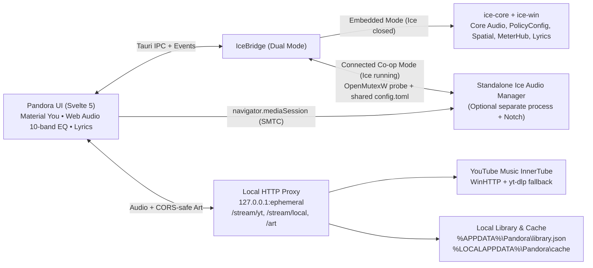

# Pandora — Native Windows Music Client Connected to Ice Audio Manager

> **Status:** Working Prototype (`pandora/`) · **Standalone Guarantee:** `ice-audio-manager` still runs **100% standalone** with zero dependency on Pandora (`app/src-tauri/src/bridge.rs` only exposes an optional loopback-only listener that sleeps with 0% CPU if nothing connects).

Pandora is a native Windows desktop music player inspired by **Vivi Music**, built with Rust + Tauri v2 + WebView2 + Web Audio DSP, and wired directly into **Ice Audio Manager**'s core crates (`ice-core` and `ice-win`).

---

## 1. Vivi Music Comparison & Feature Map

| Capability | Vivi Music (Android / Compose DE) | Pandora Prototype (Native Windows) |
|---|---|---|
| **Dynamic Material You** | Album-art palette extraction shifts app theme | Canvas palette extractor updates `--p-accent`, `--p-glow-*`, and surface tints live |
| **Animated Canvas** | Apple Music-style fluid cover backdrop | Animated multi-blob GPU-blurred canvas backdrop + live FFT spectrum in Now Playing |
| **Catalog & Streaming** | YouTube / YouTube Music InnerTube (ad-free) | Clean-room InnerTube (`search`, `browse` Home, `next` Up Next radio, `ANDROID_VR`/`IOS`/`ANDROID_MUSIC` + `yt-dlp` fallback) routed via local `127.0.0.1` Range proxy |
| **Audio Tweaks & EQ** | Equalizer, Audio Normalization, Skip Silence | Web Audio DSP pipeline: 10-band Graphic EQ (`32 Hz–16 kHz`, 7 presets), **AutoEq `ParametricEQ.txt` import** (peaking/shelf/pass `BiquadFilterNode` + preamp), `DynamicsCompressor` normalization, RMS-gated Skip Silence, playback speed, countdown + **End-of-Track** sleep timer |
| **Lyrics & Romaji** | Synced karaoke lyrics | Reuses `ice-win` LRCLIB + `ice-core` LRC parser & estimated word-sync karaoke + offline **Japanese, Korean, and Cyrillic** romanization |
| **Song Recognition** | Microphone Shazam fingerprinting (`vibrafp` + `shazamkit`) | Pure-Rust Shazam-compatible 2048-pt FFT acoustic fingerprinter + Shazam Discovery v5 API capturing either **System Audio** (WASAPI loopback) or **Microphone**, with match history, playlist/favorite actions & instant YouTube Music playback |
| **Playlist Import** | External playlist links / CSV import | Import public **YouTube Music** playlists (via InnerTube `browse`), **Spotify** playlists/albums (no API key required, matched in parallel on YouTube Music), or **Exportify CSV / M3U / tracklists**; hero mosaic playlist layout with delete confirmation |
| **Offline & Local Files** | Local caching/downloads + offline library | `%LOCALAPPDATA%\Pandora\cache\` byte-range offline audio cache + local Windows folder scanner (`.mp3/.flac/.wav/.ogg/.m4a/.opus`) |
| **Privacy-First** | Local DB, zero trackers/telemetry | `%APPDATA%\Pandora\library.json` atomic JSON store, zero analytics |
| **Windows Native Extra** | N/A | **Dual-mode Ice Audio Manager wrapper & live local bridge**: authenticated `127.0.0.1` JSON-line bridge (`bridge.json`), instant Notch Toggle / Show / Open Ice Settings, 1-click device switching, Master/Mic mute, Spatial Sound (Sonic/Atmos/DTS), 14-band WASAPI loopback meter, shared Notch & Call Mode controls, and Windows SMTC integration |
| **Pandora Settings** | Compose settings screens | Dedicated **⚙ Settings** view (`SettingsView.svelte`) saved in `library.json`: Appearance theme presets (`Midnight`, `Daylight`, `Ember`, `Use Windows`) + artwork accent toggle, Animated Canvas, Romaji Lyrics, Auto-Queue Radio, Startup Volume, SMTC broadcast, **Minimize to System Tray on Close**, Auto-Launch Standalone Ice, Sidebar Ice card, Cache/Local Folder maintenance, and Settings/EQ reset |
| **Offline Prototype Testing** | Requires network or local files | Includes 3 synthesized WAV **Demo Tracks** with custom SVG art & synced LRC (including Japanese Romaji) |

---

## 2. Architecture Overview



### How Dual-Mode Ice Integration Works

Pandora never breaks standalone `ice-audio-manager.exe` and never fights it over Windows global hotkeys (`RegisterHotKey`), Call Mode ducking, or the single-instance mutex (`Local\IceAudioManager.Desktop`):

1. **Probing without locking:** `ice_bridge.rs` checks whether standalone Ice is running using `OpenMutexW` and immediately closes the handle (`CloseHandle`). Pandora **never** holds Ice's mutex.
2. **Embedded / Wrapped Mode (`mode = "embedded"`):**
   - Active automatically when standalone `ice-audio-manager.exe` is **not** running (or `--fake-engine` is passed).
   - Pandora starts `ice_win::audio_engine::AudioEngine::start(ConfigStore::new(...))` in-process and subscribes to `Engine::subscribe()` and `Engine::meter()`.
   - Device switching, volume/mic controls, spatial sound, global hotkeys, and Call Mode all work inside Pandora without needing a second app open.
3. **Connected / Co-op & Live Bridge Mode (`mode = "connected"`, `bridgeConnected = true|false`):**
   - Active automatically whenever standalone `ice-audio-manager.exe` is running (or when you click **Launch Standalone Ice Notch** in **Ice Audio Hub** or **Settings** — Pandora drops its embedded engine *before* spawning Ice so handoff is clean).
   - Standalone Ice owns the Notch overlay, global hotkeys, and Call Mode exclusively, and exposes an authenticated `127.0.0.1:0` JSON-line bridge (`%LOCALAPPDATA%\IceAudioManager\bridge.json`, deleted cleanly on exit).
   - Over the live bridge, Pandora sends zero-latency commands directly to Ice (`command`, `ping`, `snapshot`, `toggleNotch`, `showNotch`, `openSettings`) and polls snapshot revisions so Notch/Ice changes sync back into Pandora immediately.
   - If talking to an older standalone Ice binary without `bridge.json`, Pandora gracefully falls back to direct `ice-win` Core Audio calls + `%APPDATA%\IceAudioManager\config.toml` saves.
   - When **Broadcast to Windows SMTC / Ice Notch** is enabled in Settings, Pandora publishes track title, artist, album, artwork, and timeline position via `navigator.mediaSession`, so standalone Ice's Notch automatically displays whatever Pandora is playing!

### Launching each other

Each app writes an `install.json` (`{ version, exePath, appVersion }`) in its own `%LOCALAPPDATA%` folder at every
start and keeps it after exit. The format lives in `ice_core::companion::InstallHint`.

- **Pandora → Ice:** **Launch Ice** (Ice Audio Hub or Settings, or **Auto-Launch Standalone Ice** at startup) reads
  `%LOCALAPPDATA%\IceAudioManager\install.json` first, then the usual source-checkout guesses (`target\release`,
  `target\debug`). So once Ice has run from anywhere, Pandora can start it. The button stays disabled until one is
  found.
- **Ice → Pandora:** Ice reads `%LOCALAPPDATA%\Pandora\install.json`, then `pandora\src-tauri\target\{release,debug}`
  next to its own exe. A Pandora that Ice starts for a recognition gets `--background` and stays in the tray. Pandora's
  window now starts hidden in every case and shows itself in `setup`, so a background start never flashes it.

### Ice controlling Pandora (experimental)

Pandora runs its own loopback bridge, the mirror of Ice's (`pandora/src-tauri/src/companion.rs`):
`127.0.0.1:0`, a per-run token in `%LOCALAPPDATA%\Pandora\bridge.json` (removed on exit), and one JSON line in and
one out. The protocol types are shared from `ice_core::companion`.

| Request | What Pandora does |
|---|---|
| `ping` | Answers with its version. |
| `show` | Brings its window to the front. |
| `recognize` | Listens to the PC's playback (WASAPI loopback, never the microphone), looks the song up, saves it in the recognition history, and answers `{ title, artist, album }`. One at a time, shared with the Recognize view. |

In Ice, turn on **Settings → Experimental → Notch widget** and add **Recognise song** or **Open Pandora**. Pressing one
of these buttons starts Pandora if needed, sends the request on a short `ice-pandora` thread, and pulses the button
while it waits. The answer then appears as a tray notification and in the button's tooltip. Ice never touches the
network for this: Pandora does the lookup.

### The notch widget (experimental)

**Settings → Experimental → Notch widget** replaces the notch's fixed buttons (the side rail on Floating, the toolbar
capsule on Edge Nook) with up to five buttons in your own order. The available buttons are Pin, Microphone, Lyrics,
Hibernate, Call mode, Recognise song, Open Pandora and Settings. Settings has move up/down, remove and add controls.
The list is saved in `config.toml` under `[widget]` (schema v24). While the switch is off, the notch looks exactly as
before.

---

## 3. Building & Running

In **Settings → Appearance**, choose Midnight, Daylight, Ember or Use Windows. The last option follows Windows
when its appearance changes. Album artwork accents can be turned on for any theme. Pandora stores both choices
in the local library and restores them on launch. Playback, Ice Audio and Storage have separate settings sections.

All commands run from **PowerShell** (not Git Bash, so MSVC `link.exe` is used):

### Build & Run Pandora Prototype
```powershell
# One-click debug build + launch
.\pandora\build.cmd run

# Or run with demo WAV tracks enabled (for testing without YouTube/local files)
cargo run --manifest-path pandora\src-tauri\Cargo.toml -- --demo

# Or run with fake audio devices (no real audio hardware needed)
cargo run --manifest-path pandora\src-tauri\Cargo.toml -- --fake-engine --demo

# Check UI types + build + Rust tests
.\pandora\build.cmd check
```

### Run Both Together (Co-op Mode)
1. Start Ice Audio Manager standalone (`.\build.cmd run` or from `target\release\ice-audio-manager.exe`).
2. Start Pandora (`.\pandora\build.cmd run`) — or click **Launch Standalone Ice Notch** inside Pandora's **Ice Audio Hub** tab.
3. Play any track in Pandora: the **Ice Notch** displays the track via Windows SMTC, while Pandora switches to `Connected (Co-op)` mode and controls your output devices and Notch settings seamlessly.

---

## 4. Prototype Limitations & Honest Rough Edges

- **YouTube InnerTube stream extraction:** YouTube frequently rotates signature/cipher requirements across InnerTube client IDs. Pandora tries `ANDROID_VR`, `IOS`, and `ANDROID_MUSIC` clients first and falls back to `yt-dlp` on `PATH` if available. Installing `yt-dlp` makes edge-case tracks much more reliable.
- **Local file metadata:** The prototype folder scanner reads filenames (`Artist - Title.ext`) and parent folder names rather than full ID3/Vorbis tag parsing (no extra `lofty` dependency was added yet).
- **Web Audio EQ vs Hardware WASAPI:** The 10-band EQ, Compressor Normalization, and Skip Silence run in WebView2's Web Audio graph (`48 kHz` shared-mode Windows mixer). Bit-perfect WASAPI Exclusive mode would require moving decoding + DSP to Rust.
- **Prototype scope:** Pandora deliberately ignores Ice Audio Manager's strict production rules (e.g., CSP permits local proxy + YouTube art hosts, no automated UI/memory budgets enforced yet) so we can iterate quickly on product feel first.

---

## 5. Strategic Direction Options (What Next?)

Once you test this prototype, here are the four main directions we can take:

1. **Option A — Companion Suite (Recommended):** Keep `ice-audio-manager` ultra-lean as a standalone system utility (Notch + Device Switcher + Call Mode) and add a tiny local **Named Pipe / JSON-RPC bridge** between Ice and Pandora.
   - *Pros:* Ice stays sub-30 MB for users who only want the Notch/audio switcher; Pandora gets zero-latency two-way sync (exact lyrics offset, custom actions, instant Notch toggle) without `config.toml` polling or SMTC guesswork.
2. **Option B — Unified Super-App:** Fold Ice's Notch window and tray engine directly into Pandora as an optional toggleable module.
   - *Pros:* Single installer, single process, shared album-art cache and lyrics cache.
   - *Cons:* Heavier always-on memory footprint if the user only wants background device switching.
3. **Option C — Pure Rust Audio + Native/GPUI Engine:** Replace `<audio>` + Web Audio DSP with a Rust audio pipeline (`symphonia` decode + `cpal`/WASAPI output + Rust biquad EQ + optional WASAPI Exclusive), optionally moving UI from WebView2 to WinUI 3 or GPUI.
   - *Pros:* Lower idle RAM, gapless playback, bit-perfect Hi-Res output, true ReplayGain/EBU R128 normalization.
4. **Option D — Shared `ice-ipc` Ecosystem:** Extract the bridge from Option A into a small `ice-ipc` crate so Pandora *and* any future desktop tool can integrate with Ice Audio Manager cleanly.
